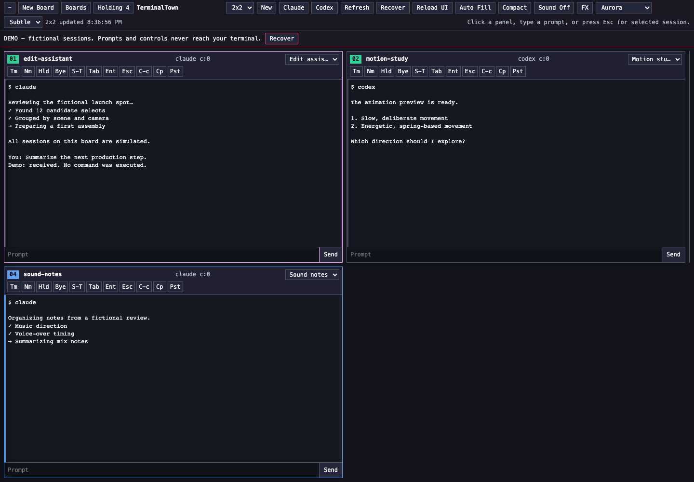

# TerminalTown

**See and control your terminal sessions in one board.**

TerminalTown renders tmux snapshots in a single browser board. Arrange sessions in slots, move them into Holding, send prompts, and keep work visible without opening a separate terminal window for every agent.

The public edition includes an interactive simulation so the board can be explored without launching an agent or exposing a terminal.

## What it does

- Resizable session grid and multiple boards.
- Session labels, prompt input, key controls, and Holding.
- Persistent layouts and session recovery in live mode.
- Visual themes and reduced-motion controls.
- Default simulation with fictional sessions and no host clipboard or process access.

## Run it

Requires Node.js 22+. The demo has no npm dependencies.

~~~sh
npm start
npm test
~~~

Open **http://localhost:17896**. All demo controls operate on simulated sessions in memory; restarting resets the simulation.

For your own tmux sessions, install tmux separately and opt into live mode:

~~~sh
npm run live
~~~

Live mode controls real local sessions, including sending commands and ending sessions when requested. Use an isolated tmux setup while learning the controls. Claude and Codex are optional executables you install yourself; default launches preserve their normal permission behavior.

`TERMINALTOWN_PROJECT_ROOT` sets the working directory. `TERMINALTOWN_DATA_DIR` sets independent layout/recovery storage; by default this edition uses `~/.local/share/terminaltown-public`. `TERMINALTOWN_BROWSER_PORT` changes the port. The server binds only to loopback.

## How it works

`src/aiGrid.js` contains the original board renderer and tmux integration. `src/demo.js` replaces host operations with an in-memory simulation. `scripts/terminaltown-browser.js` serves the board with host/origin checks and JSON-only control requests.

## Scope and limitations

This first public edition is browser-based. The desktop/VS Code integrations and project-specific maps are not included. The simulation was tested independently; agent-specific recovery is experimental and depends on installed CLI versions. Automatic agent restarts are off unless `TERMINALTOWN_AUTO_RECOVER=1` is explicitly set. Do not expose this control server directly to the internet.

## About the work

Created by **Beau Scheier**, a commercial producer building tools for production, creative work, and coordinating development. Product direction and workflow design draw on that production practice; development includes AI assistance. This repository is a standalone portfolio edition.

[Production portfolio](https://prod.beauscheier.com/) · [More tools](https://github.com/OhandAredotjGN)

See [NOTICE.md](NOTICE.md) for rights and dependency attribution.
