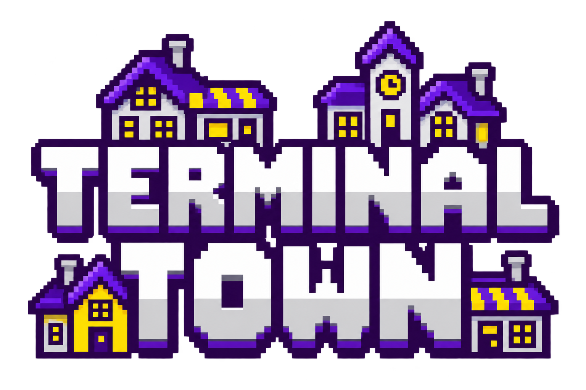

# TerminalTown

**See and control your terminal sessions in one board.**

TerminalTown renders tmux snapshots in a single browser board. Arrange sessions in slots, move them into Holding, send prompts, and keep work visible without opening a separate terminal window for every agent.

The public edition includes an interactive simulation so the board can be explored without launching an agent or exposing a terminal.

This repository is kept as a public-safe edition of the fuller local TerminalTown
application. Public updates are prepared on a reviewable branch from the local
renderer, while internal VS Code, host-layout, runtime-evidence, and session
data remain outside this repository. Host-specific paths and privileged
agent defaults are supplied only through explicit environment configuration.

## What it does

- Resizable session grid and multiple boards.
- Session labels, prompt input, key controls, and Holding.
- Session Finder across placed and held work, with purpose and board context.
- Panel-health observation in the browser, including a clear standalone-demo status.
- Safer rendering for wrapped URLs, local artifact references, and long agent transcripts.
- Persistent layouts and session recovery in live mode.
- Visual themes and reduced-motion controls.
- Default simulation with fictional sessions and no host clipboard or process access.

## Run it

Requires Node.js 22+. The demo has no npm dependencies.

~~~sh
npm start
npm test
~~~

Open **http://localhost:17896**. All demo controls operate on simulated sessions in memory; restarting resets the simulation.

For your own tmux sessions, install tmux separately and opt into live mode:

~~~sh
npm run live
~~~

Live mode controls real local sessions, including sending commands and ending sessions when requested. Use an isolated tmux setup while learning the controls. Claude and Codex are optional executables you install yourself; default launches preserve their normal permission behavior.

`TERMINALTOWN_PROJECT_ROOT` sets the working directory. `TERMINALTOWN_DATA_DIR` sets independent layout/recovery storage; by default this edition uses `~/.local/share/terminaltown-public`. `TERMINALTOWN_BROWSER_PORT` changes the port. The server binds only to loopback.

`TERMINALTOWN_CLAUDE_COMMAND` and `TERMINALTOWN_CODEX_COMMAND` can explicitly customize new agent launches. Their defaults are `claude` and `codex`. Initial prompts are one-time tasks; use Session memory to save a lasting charter and context. The Meta Terminal opens a separate Codex session in live mode and a simulated session in the demo.

## How it works

`src/aiGrid.js` contains the shared board renderer and optional tmux integration. The renderer is split into small browser helpers for preferences, panel health, session search, artifact-reference handling, and responsive controls. `src/demo.js` replaces host operations with an in-memory simulation. `scripts/terminaltown-browser.js` serves the board with host/origin checks, JSON-only control requests, demo session search, and in-memory health reporting.

## Scope and limitations

This first public edition is browser-based. Desktop/VS Code integrations, private project maps, external-terminal handoff, and artifact bytes remain host-specific and are not enabled by default. The simulation was tested independently; agent-specific recovery is experimental and depends on installed CLI versions. Automatic agent restarts are off unless `TERMINALTOWN_AUTO_RECOVER=1` is explicitly set. Do not expose this control server directly to the internet.

Automatic context rotation is also off by default. Set `TERMINALTOWN_ROTATION=1` only to allow idle, detached sessions with an approved charter to save context, clear their conversation, and reload memory. Memory prompts include the bundled `scripts/terminaltown-session-memory.js` command with the correct session and manifest; charter proposals require approval in the UI.

Public syncs are prepared on a reviewable branch from the local renderer. The public server is intentionally a separate adapter: it keeps the renderer improvements while preventing private host paths, dashboards, credentials, and runtime evidence from becoming repository dependencies.

## About the work

Created by **Beau Scheier**, a commercial producer building tools for production, creative work, and coordinating development. Product direction and workflow design draw on that production practice; development includes AI assistance. This repository is a standalone portfolio edition.

[Production portfolio](https://prod.beauscheier.com/) · [More tools](https://github.com/OhandAredotjGN)

See [NOTICE.md](NOTICE.md) for rights and dependency attribution.
